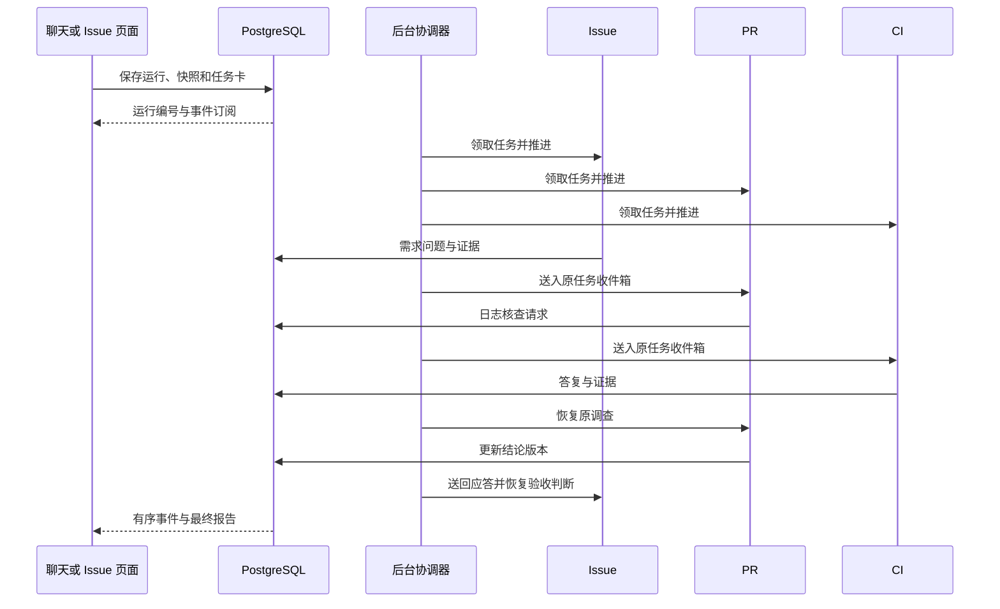

# Agent 调查与反馈工作流

工程审查和 Issue 分析由 PostgreSQL 中的运行记录驱动。聊天请求只提交任务，后台协调器逐步推进；页面关闭或连接断开不取消任务。应用启动后领取未完成运行，沿用已保存的预算和检查点。

## 入口与角色

- `workflow.run_engineering_review` 和确认计划入口交给 `WorkflowOrchestrator.submit`，立即返回运行编号、状态和订阅地址。
- Issue 页面、Issue 流式接口、聊天 `issue_agent.analyze_issue` 和工作流 `issue_analysis` 都使用 `IssueAgent` 与同一个共享调查循环。
- PR、CI 页面及其流式接口、聊天直接分析和 PR 检查清单入口也提交同一后台模块，使用各自固定目标；不再另行生成公开分析过程。
- 三个角色的 `run()` 都只提交持久化调查，`decide()` 执行共享原生决策；角色类不再包含一次性模型分析或规则结果回退。目标解析不再构造同步角色 runner。
- Planner 按目标选择角色。Issue 必须明确指定编号或 UUID；只有用户明确要求最新 Issue 时选择最新记录。目标 PR 的明确需求关联可以提供 Issue 候选，Planner 决定是否需要该角色。
- 调查中需要新增角色时，用 `planner.request_task` 提交快照目标和调查要求，由 Planner 追加任务。角色不能递归调用自己的分析入口。

## 固定材料

PR 保存 base/head SHA 和合成合并提交；CI 保存 commit、关联 PR、attempt、workflow 路径，并冻结 jobs 与日志。未指定 CI 时，只选择与目标 PR 版本匹配的最新失败运行；缺失就是缺口。

Issue 保存标题、正文、状态、标签、分配人员、更新时间和内容摘要值。候选 Issue、项目文档、会话和团队资料在提交时进入同一快照；实际读取片段另存为证据。独立 Issue 分析固定当时 checkout 的 HEAD SHA，参与 PR 审查时读取共同的 PR 代码版本。

本地仓库按 SHA 归档；托管仓库通过只读的固定 SHA archive 和 compare 请求准备材料。不会在读取失败后切换默认分支。GitHub 推荐用提交 ID 获取稳定文件内容，见 [固定版本归档](https://docs.github.com/en/repositories/working-with-files/using-files/downloading-source-code-archives)。归档保存在数据库，与后续 checkout 同步和 worktree 清理分离；模型只读取已固定的归档。

## 共享调查循环

每次推进一个模型决策或一个已保存的待执行工具调用：

1. 领取任务租约，保存调用意图和预算预留后提交事务。
2. 在数据库事务之外调用模型或材料工具。
3. 将真实响应、检查点、证据、出站消息和事件一起提交。
4. 继续调查、等待协作或返回带版本的结果。

角色工具由 `services/agents/investigation.py` 限定：

| 角色 | 材料工具 | 完成契约 |
|---|---|---|
| Issue | `issue.read`、`team.read`、材料检索和完整内容、固定代码 | `IssueFinish`，保留 `IssueAnalysisOutput` 字段 |
| PR | `pr.read_diff`、实现/调用方/测试、相关需求材料 | `PRFinish`，保留 `PRReviewOutput` |
| CI | 固定 attempt 的 jobs/日志/失败测试、workflow 与依赖 | `CIFinish`，保留 `CIDebugOutput` 并分开报告原因、PR 关系和门禁 |

`materials.search` 明确使用快照关键词检索，分数只用于发现候选；`materials.read` 可按字符继续读取。Issue 的重复判断要求先读取双方完整内容。负责人仅来自已读取的项目团队画像或已分配人员，否则保留待分配。公开过程来自实际工具调用，不再单独让模型补写“公开分析过程”。

`code.list` 列出固定归档中的可读文件，供角色发现 workflow、依赖、实现和测试的实际路径；`code.search` 搜索文件内容中的字面字符串。Issue 的相似候选检索排除目标本身，未读完的候选进入未解决项。

每角色累计 8 次模型、16 次工具、180 秒；工作流累计活跃时间 300 秒，三个角色可以并发。单次模型最多 30 秒、材料工具最多 15 秒。已提交工具响应直接复用；未保存响应的调用记录为中断，结束受影响任务，不自动重试。模型失败不会生成规则业务结果冒充完成调查。

## 三方协作与补查

`collaboration.request(target, question, evidence_refs, conclusion_ids)` 的目标可以是本次运行中的三个角色。请求后保存检查点并交还控制权；等待中的角色仍能处理收到的问题，基础调查完成的角色也能被唤起。`collaboration.respond` 把答复送回原任务。相同请求复用已有答复，协作链最多两轮。

Observer 对具体结论编号给出缺少的依据、负责角色、问题和完成要求，直接写入原任务收件箱。最多两轮补查，只恢复受影响任务；缺少用户复现或团队配置时保留待用户补充项。CI 失败不跳过因果关系核查，合并门禁独立保留。

合并门禁直接绑定固定快照中的失败 CI，即使 CI 角色尚未执行、没有有效结果或 Observer 调用失败，也不会放行。PR 业务结果会附带该阻塞项，Synthesis 的权威决策同样受此约束。

Observer 和 Synthesis 只用最新结论版本与真实证据，历史版本、关联消息和证据编号保留在时间线。Synthesis 输出综合报告与未解决问题；时间或调用预算用尽时保留事实性部分报告。Issue 的最新有效业务结果写入 `AnalysisResult`，关联运行、任务、快照和结果版本。

补查更新结论但未重新完成业务结果时，旧业务结果明确标记为早于最新结论，其待查项作为历史内容保留；当前未解决项取最新结论、实际错误及尚未答复的请求。Observer 新增任务必须绑定快照中可用的明确目标，非法目标直接记录为 Observer 失败并交回综合阶段。

## 持久化与前端

任务和运行分别持有租约；外部模型调用期间不持有事务。写回时按运行序列化事件和出站消息的提交，事件编号可安全用于断线续读。取消请求在当前推进结束后生效。

聊天任务卡在提交时创建，报告更新同一条消息。主页面 Issue/PR/CI 面板、三个独立角色页面、聊天和运行记录页复用 `WorkflowRunCard`，展示预算、真实调用、三方问答、证据位置、结论历史和未解决项。角色页面通过各自的 `analysis-run` 找回已有运行，重新分析才创建新运行。

聊天响应保存与后台最终报告使用同一运行行锁；保存时刷新 ORM 缓存，以原卡的当前内容和工作流状态写入聊天响应及 `AgentRun`。前端已收到任务卡最终报告后，保留该报告，避免迟到的提交响应将消息恢复成排队文本。

增量迁移位于 `db/review_migration.py`，启动时在建新表后应用，历史完成记录仍通过运行列表和详情可查看。活跃快照保留到执行结束；删除聊天不会中断其独立运行。
