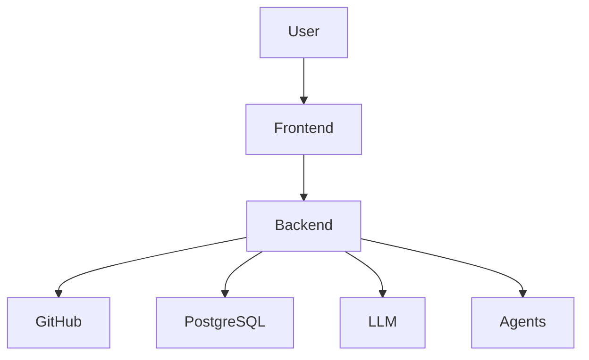

# System Design

Devcooper 使用 Next.js 前端、FastAPI 后端、PostgreSQL/pgvector 数据层和自定义多 Agent 工作流。

工程调查使用 PostgreSQL 持久化协调：提交立即创建运行、固定材料和聊天任务卡；后台任务租约逐步推进 Issue/PR/CI，共享原生工具循环、证据和协作消息。没有新增消息中间件。模型调用在事务之外执行，检查点与事件原子提交，重启继续未完成运行。具体协议见 [Agent 调查与反馈工作流](agent_workflow.md)。
